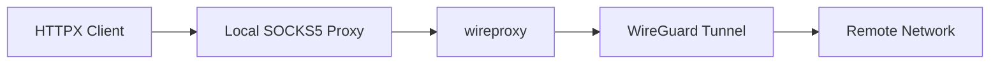
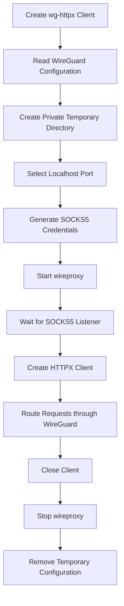

<a id="readme-top"></a>

<div align="center">

# wg-httpx

Route individual HTTPX clients through WireGuard with a userspace tunnel scoped to each client.

[](https://pypi.org/project/wg-httpx/)
[](https://pypi.org/project/wg-httpx/)
[](https://github.com/henrikxyz/wg-httpx/actions/workflows/ci.yml)
[](LICENSE)

</div>

---

## About

`wg-httpx` provides `httpx.Client` and `httpx.AsyncClient` implementations whose requests travel through a WireGuard tunnel in userspace.

Each managed client runs through an isolated [`wireproxy`](https://github.com/windtf/wireproxy) process and connects to it through a private SOCKS5 listener on `127.0.0.1`.

The result is a WireGuard route scoped specifically to the HTTPX client while the host networking configuration stays unchanged.



This approach is useful for applications that want selected HTTP traffic to use a WireGuard peer while other applications continue using their existing network path.

<p align="right"><a href="#readme-top">↑ Back to top</a></p>

## Installation

Install from PyPI:

```console
pip install wg-httpx
```

Or with [`uv`](https://docs.astral.sh/uv/):

```console
uv add wg-httpx
```

Requirements:

* Python 3.11+
* a valid WireGuard configuration

Published platform wheels include a matching `wireproxy` binary, providing a ready-to-use installation on supported platforms.

<p align="right"><a href="#readme-top">↑ Back to top</a></p>

## Usage

### Synchronous client

```python
import wg_httpx

with wg_httpx.Client("wg.conf") as client:
    response = client.get("https://api.ipify.org")
    print(response.text)
```

`wg_httpx.Client` follows the normal `httpx.Client` interface while routing its connections through the managed WireGuard tunnel.

### Asynchronous client

```python
import asyncio

import wg_httpx


async def main() -> None:
    async with wg_httpx.AsyncClient("wg.conf") as client:
        response = await client.get("https://api.ipify.org")
        print(response.text)


asyncio.run(main())
```

### HTTPX options

Standard HTTPX client options can be passed directly:

```python
with wg_httpx.Client(
    "wg.conf",
    timeout=20,
    follow_redirects=True,
    http2=True,
) as client:
    response = client.get("https://example.com")
```

`wg-httpx` owns the `proxy` and `transport` configuration so the managed client consistently uses its WireGuard route.

Environment proxy handling defaults to `trust_env=False`, keeping the managed route predictable across environments.

### Raw WireGuard configuration

A configuration string can be supplied directly:

```python
import wg_httpx

config = """
[Interface]
Address = 10.0.0.2/32
PrivateKey = ...
DNS = 10.0.0.1

[Peer]
PublicKey = ...
Endpoint = vpn.example.com:51820
AllowedIPs = 0.0.0.0/0
"""

with wg_httpx.Client(config) as client:
    response = client.get("https://api.ipify.org")
    print(response.text)
```

Using a context manager gives the client a clear lifecycle and automatically cleans up its managed resources.

<p align="right"><a href="#readme-top">↑ Back to top</a></p>

## How It Works

When a managed client starts, `wg-httpx` prepares an isolated WireGuard route specifically for that client.



The startup sequence performs the following steps:

1. Read the supplied WireGuard configuration.
2. Create a private temporary configuration directory.
3. Select an available localhost port.
4. Generate random SOCKS5 credentials.
5. Start an isolated `wireproxy` process.
6. Wait until its SOCKS5 listener is ready.
7. Configure HTTPX to use the local proxy.

When the client closes, `wg-httpx` stops the associated `wireproxy` process and removes the temporary configuration.

Context managers provide the simplest lifecycle:

```python
with wg_httpx.Client("wg.conf") as client:
    ...
```

The asynchronous equivalent uses the same pattern:

```python
async with wg_httpx.AsyncClient("wg.conf") as client:
    ...
```

<p align="right"><a href="#readme-top">↑ Back to top</a></p>

## wireproxy Binary

`wg-httpx` resolves the `wireproxy` executable in the following order:

1. `wireproxy_binary=...`
2. `WG_HTTPX_WIREPROXY`
3. the binary bundled with the package
4. `wireproxy` available on `PATH`

To select a custom binary directly:

```python
with wg_httpx.Client(
    "wg.conf",
    wireproxy_binary="/path/to/wireproxy",
) as client:
    ...
```

The same path can be configured through the environment:

```console
export WG_HTTPX_WIREPROXY=/path/to/wireproxy
```

### Supported wheels

| Platform | x86-64 | ARM64 |
| -------- | :----: | :---: |
| Windows  |    ✓   |   ✓   |
| Linux    |    ✓   |   ✓   |
| macOS    |    ✓   |   ✓   |

<p align="right"><a href="#readme-top">↑ Back to top</a></p>

## Security

The managed proxy is scoped locally to the client lifecycle.

* The SOCKS5 listener binds to `127.0.0.1`.
* Each client receives randomly generated SOCKS5 credentials.
* WireGuard configuration data is stored in a private temporary directory.
* Temporary configuration files are removed when the client closes.
* HTTP proxy environment handling defaults to `trust_env=False`.
* The WireGuard private key is available to the managed `wireproxy` subprocess while the tunnel is active.

This design keeps the tunnel isolated to the managed HTTP client and gives its temporary resources a defined lifecycle.

<p align="right"><a href="#readme-top">↑ Back to top</a></p>

## Development

Clone the repository:

```console
git clone https://github.com/henrikxyz/wg-httpx.git
cd wg-httpx
```

Install the development environment:

```console
uv sync --dev
```

Run linting and tests:

```console
uv run ruff check .
uv run ruff format --check .
uv run pytest
```

Build a wheel:

```console
uv build --wheel
```

For source development, build the bundled `wireproxy` binary with:

```console
uv run python scripts/build_wireproxy.py
```

The unit test suite uses isolated test fixtures, while end-to-end network testing can be performed with a working WireGuard peer.

<p align="right"><a href="#readme-top">↑ Back to top</a></p>

## License

The Python wrapper is available under the [MIT License](LICENSE).

Bundled `wireproxy` binaries retain the upstream ISC license. See [THIRD_PARTY_NOTICES.md](THIRD_PARTY_NOTICES.md).

<p align="right"><a href="#readme-top">↑ Back to top</a></p>
